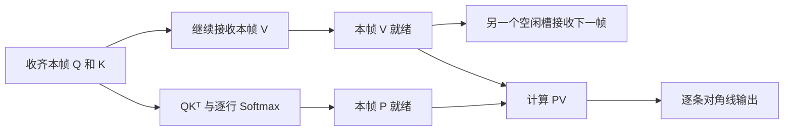

# Mini_Attention 数值与架构契约

本项目计算 `Y = Softmax(QKᵀ / 4)V`。矩阵均为 16×16，Softmax 按行执行；不包含 Q/K/V 投影、多头拼接、掩码、训练或 KV cache。合法输入为 `[-2,2]` 内的有限 IEEE 754 binary16 值，含正负零和次正规数。

## 1. 全 FP16 的含义

Q、K、V、P、Y、阵列链路和 PE 累加器均使用 16-bit binary16。Softmax 各次加、减、乘、除及指数输出也回到 binary16。舍入方式统一为 round-to-nearest, ties-to-even（RNE）；不启用 flush-to-zero。

IEEE 浮点运算器为保证正确舍入而使用扩展尾数、guard/round/sticky 位，以及 HardFloat 的 17-bit recFN 等价编码；这些是算子内部表达，不构成 FP32 累加或更高精度的矩阵状态。异常标志目前不进入顶层接口；合法输入及稳定 Softmax 保证除数非零，系统验证还检查输出有限。

`FMA16(a,b,c)` 表示精确计算乘加后只舍入一次到 binary16。不得替换为 `ADD16(MUL16(a,b),c)`，后者有两次舍入。下列顺序是软件逐位模型和 RTL 的共同契约。

## 2. 精确运算顺序

对每个 `i,j`：

1. `acc = +0`。
2. `k = 0..15`，依次 `acc = FMA16(Q[i,k], K[j,k], acc)`。
3. `S[i,j] = MUL16(acc, 0.25)`；0.25 的 binary16 编码是 `0x3400`。

对每一行 `i`：

1. `m = max(S[i,0], ..., S[i,15])`，按数值比较，而非无符号编码比较。
2. `delta[j] = SUB16(S[i,j], m)`。
3. `E[j] = EXP16(delta[j])`，指数 ROM 接受该 binary16 差值并输出舍入后的 binary16。
4. 用四层平衡加法树求分母。第一层从 `E[0..15]` 开始，相邻两项配对，即 `next[t] = ADD16(level[2*t], level[2*t+1])`。对每层结果重复相同配对，项数依次变为 8、4、2、1。每个节点单独按 RNE 舍入至 FP16，最后一个节点的输出即分母 `d`。
5. `P[i,j] = DIV16(E[j],d)`，显式存储 FP16 概率矩阵。

对每个 `i,j`：

1. `acc = +0`。
2. `k = 0..15`，依次 `acc = FMA16(P[i,k], V[k,j], acc)`。
3. `Y[i,j] = acc`。

QKᵀ 和 PV 中的点积均按 k 递增执行 FMA。旧版串行 Softmax 按列从左到右累加分母；同一行指数值在新旧两种顺序下可能舍入到不同的 FP16 分母和输出。独立 float64 参考直接计算数学注意力。

数学上的 QK 点积范围为 [-64,64]、缩放分数为 [-16,16]、减最大值后为 [-32,0]。至少一个指数为 1，该 FP16 加法树的分母在 [1,16]，除法不会除零。FP16 概率行和不保证逐位等于 1，输出也不应采用精确实数凸组合的严格边界来替代误差检查。

## 3. 指数 ROM

ROM 的索引是非正 binary16 输入的绝对值编码 `delta[14:0]`，不是均匀实数采样点。其内容为 `RN16(exp(-decode_half(index)))`。

- `+0`、`-0` 均输出 `0x3c00`（1）。
- 编码 `0x0000..0x4c55` 共 19,542 项，每项 16 bit，表数据 39,084 byte，约 38.2 KiB。
- 非正输入的绝对值编码 ≥ `0x4c56` 时，指数已小于 FP16 舍入为零的门限，输出 `0x0000`。
- 生成时使用高精度 Decimal。逐位模型读取同一份规范 ROM；其数值正确性还需由高精度重生成与独立指数计算检查，不能仅以模型和 RTL 读取同表作为依据。

ROM 文本文件需要随 RTL 一同交付；综合工具应从工程根目录解析初始化文件路径。`$readmemh` 是 ROM 初始化，具体 FPGA/ASIC 的 ROM 映射尚需目标工具验证。

## 4. 阵列数据流

### 输出驻留（OS）

256 个 PE 排列为 16×16，每个 PE 有一份 FP16 `acc`。A 操作数向右、B 操作数向下逐 PE 传递；每个有效逻辑步只在两侧输入均有效时更新该 PE 的累加值。无效项保持 `acc`，而不是执行一次零乘加。

| 阶段 | 左边第 i 行，步 t | 上边第 j 列，步 t | PE[i,j] 的结果 |
|---|---|---|---|
| QKᵀ | Q[i,t−i] | K[j,t−j] | 两行的长度 16 点积 |
| PV | P[i,t−i] | V[t−j,j] | P 的行与 V 的列的点积 |

越界索引产生无效标记。相同的内积索引 k 在 `t=k+i+j` 于 PE[i,j] 相遇。因此 t 从 0 到 45 共 46 个启用步，最后一个 PE 恰好完成 16 个有效 FMA。每轮阵列总计 4,096 次有效 FMA。K 直接按行读取，无需物理转置。

当前 PE 使用组合 FMA，启用步在一个时钟边沿完成一次累加和转发；该设计可能有较长组合关键路径。46 是阵列有效步数，不包括清零、输入装载、Softmax、结果输出和协议停顿，不代表已经验证了任何运行频率。后续给 FMA 添加多级流水时必须处理累加反馈依赖，不能只延迟 valid 而继续每拍覆盖同一 acc。

`clear` 高于 `step`，同时清除累加值和链路 valid；`step=0` 保持链路和累加器。全局低有效异步复位中止整个任务。

### 权重驻留（WS）

顶层以 `USE_WS=0` 选择 OS，以 `USE_WS=1` 选择 WS。展开时只实例化一种阵列，两次 GEMM 共用它。设 C=AB，WS 的物理坐标是 PE[k,j]。计算开始前，用 16 拍从上边界按 k=15 到 0 依次送入 B 的一行并向下移位。装满后，每个 PE 的 FP16 权重寄存器持有 B[k,j]。

| 乘法 | PE[k,j] 驻留的 B[k,j] | 左边界第 k 行在计算步 t 输入 |
|---|---|---|
| QKᵀ | K[j,k] | Q[t−k,k] |
| PV | V[k,j] | P[t−k,k] |

设输出行 i=t−k，只有 i 在 [0,15] 内时才送有效数据。A 向右传，在步 i+k+j 到达 PE[k,j]。部分和从顶部的 FP16 +0 开始，每拍向下传一行，同时消耗同一输出的下一项 k。底行在步 i+15+j 锁存 C[i,j]，对应列在下一拍将它写入结果缓存。首个输出在 t=16 写回，最后一个在 t=46 写回，每轮共 16 个装权拍和 47 个计算/收集拍。两轮分别重装 Kᵀ 和 V，每帧比 OS 多 34 个阵列调度周期，均单独计清零。

例如，第一轮计算 C[0,1] 时，t=1 的 PE[0,1] 读 Q[0,0]、K[1,0] 和 +0。t=2 的 PE[1,1] 将这份部分和与 Q[0,1]、K[1,1] 做 FMA，直到 t=16 的 PE[15,1] 完成。t=17 写回 C[0,1]。权重在这些计算拍中保持，直到下次装权或复位。

## 5. 输入双缓冲与计算调度

Q、K、V 各有两个帧槽，输入端按握手计数。接收第 512 个字（K 的末字）后，计算端即可清阵列、执行 QKᵀ 并启动 16 行并行 Softmax。此时写入端继续接收同帧 V；当整帧 768 个字全部收到后，写入端切换到另一个可用槽并接收下一帧。QKᵀ 和 PV 共用一个阵列，P 暂存在计算端。P 与同帧 V 二者都齐备后才启动 PV。WS 在每轮计算前装入对应权重。

写入端和计算端各维护一个槽号。末组输出握手后释放计算槽，再按接收先后处理下一槽。两个槽均已占用时，`in_ready` 拉低。全局复位清除两个槽的有效标志、两套索引和所有在途输出标志；重新开始的帧会完整覆盖所用数据。

两个槽中的 Q/K/V 共占 3,072 byte，P 占 512 byte。OS 的 PE 累加器合计 512 byte；WS 的权重、逐级部分和、阵列结果缓存各有 256 个 FP16 字。出口另存一组 256-bit 数据、掩码和帧尾标志，可吸收第一拍背压。上述数据位数与目标器件的实际存储资源映射需分别统计。

## 6. 外部握手与 16 路输出

- 输入保留 `in_data[15:0]`。上升沿 `in_valid && in_ready` 接收一个 FP16 字。每帧依次为行优先的 Q、K、V，各 256 字。接收下一帧可以与上一帧计算、输出重叠。
- 输出为 `out_data[255:0]`、`out_lane_valid[15:0]`、`out_valid`、`out_ready`、`out_last`。整组只在上升沿 `out_valid && out_ready` 时传输。第 j 列使用 `out_data[16*j +: 16]`，掩码置位时有效。下游按每列独立的接收计数即可还原行号。
- 每帧输出 31 组。令 d 为本帧此前成功握手的组数（0 到 30），仅当 `0 <= d-j < 16` 时，第 j 路携带 `Y[d-j,j]`。掩码从 `0x0001`、`0x0003` 逐步扩大至 `0xffff`，再收缩至 `0x8000`。最后一组带 `out_last=1`。
- PV 的计算步从 0 计。OS 在步 `15+d` 的上升沿锁存第 d 条对角线；WS 在步 `16+d` 的上升沿将它写入阵列结果缓存。下游就绪时直接看到该组，可在下一个上升沿握手。阵列继续推进后续对角线。
- 下游暂停时，出口数据、掩码、帧尾和有效位保持稳定。一个旁路缓冲槽先保存阻塞的组，下一组可留在阵列输出寄存器。两处均有待传组时，PV 计数、阵列数据和有效位一起暂停。背压解除后先发送最早的组。
- `busy` 表示有部分接收或在处理的帧，可与 `in_ready` 同时有效。每帧最后一组握手后 `done` 拉高一个周期，即使下一帧已入队。低有效异步复位丢弃所有未完成帧，恢复后从新的 Q 的首字开始。

首结果延迟与整帧延迟均从本帧首次输入握手开始，分别到首次、末次输出握手为止，含首尾两个周期。输入帧间隔（II）是连续两帧首次输入握手所在周期的差。持续供数、下游持续就绪时，每帧的 768 个输入字给出 II 的下界 768 拍。

## 7. 验收边界

RTL 每个输出须与 SoftFloat 位模型逐位一致且有限；相同 FP16 输入的 float64 数学参考用于逐帧 RMSE ≤ 0.06、逐元素最大绝对误差 ≤ 0.20。通过仿真不能推出综合面积、最高频率、功耗、布线或板级正确性；已执行和未验证项见 EXPERIMENTS.md。
